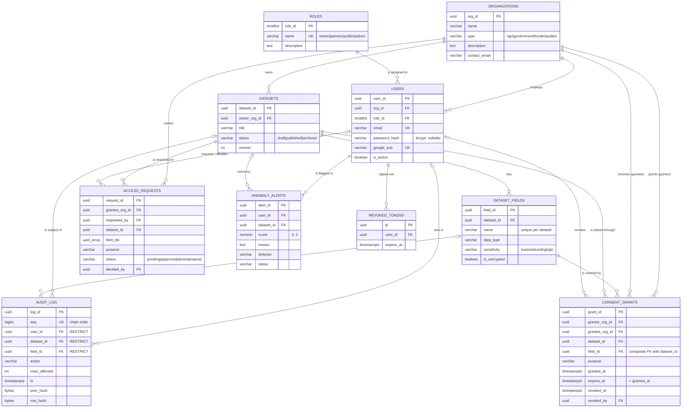

# ConsentLedger: ER Diagram, Relational Schema and Normalization

Nine core entities (plus a small `revoked_tokens` table for logout):
Organization, User, Role, Dataset, DatasetField, ConsentGrant, AccessRequest,
AuditLog, AnomalyAlert. The schema is in third normal form. Column-level detail
is in [`DATA_DICTIONARY.md`](DATA_DICTIONARY.md).

## ER diagram

GitHub renders this Mermaid diagram. Crow's-foot notation: `||` exactly one,
`o|` zero or one, `}o` zero or many, `}|` one or many.

## Relationships and cardinality

| # | Relationship | Cardinality | Implemented by | On delete |
|---|---|---|---|---|
| 1 | Organization employs User | 1 : N | `users.org_id` | cascade |
| 2 | Role is assigned to User | 1 : N | `users.role_id` | restrict |
| 3 | Organization owns Dataset | 1 : N | `datasets.owner_org_id` | cascade |
| 4 | Dataset has DatasetField | 1 : N | `dataset_fields.dataset_id` | cascade |
| 5 | **Organization M : N Dataset (field level), through ConsentGrant** | M : N | `consent_grants(grantee_org_id, field_id, dataset_id)` | cascade |
| 6 | Organization grants ConsentGrant | 1 : N | `consent_grants.grantor_org_id` | cascade |
| 7 | DatasetField is covered by ConsentGrant | 1 : N | composite FK `(field_id, dataset_id)` | cascade |
| 8 | Organization makes AccessRequest | 1 : N | `access_requests.grantee_org_id` | cascade |
| 9 | Dataset is requested in AccessRequest | 1 : N | `access_requests.dataset_id` | cascade |
| 10 | User requests / decides AccessRequest | 1 : N (optional) | `requested_by`, `decided_by` | set null |
| 11 | User revokes ConsentGrant | 1 : N (optional) | `consent_grants.revoked_by` | set null |
| 12 | User / Dataset / Field appear in AuditLog | 1 : N (optional) | `audit_log.user_id`, `dataset_id`, `field_id` | **restrict** |
| 13 | User is flagged in AnomalyAlert | 1 : N | `anomaly_alerts.user_id` | cascade |
| 14 | Dataset concerned by AnomalyAlert | 1 : N (optional) | `anomaly_alerts.dataset_id` | set null |

Audit foreign keys use `RESTRICT`: a user, dataset or field that appears in the
trail can never be deleted (users are deactivated and datasets archived
instead), so history always points at real rows and the append-only table never
takes part in a cascade.

## Relational schema

Primary keys are marked **PK**, foreign keys **FK**.

- **organizations**(org_id **PK**, name, type, description, contact_email, created_at, updated_at)
- **roles**(role_id **PK**, name *unique*, description, created_at)
- **users**(user_id **PK**, org_id **FK**→organizations, role_id **FK**→roles, email *unique*, password_hash, google_sub *unique*, full_name, is_active, last_login, created_at, updated_at)
- **datasets**(dataset_id **PK**, owner_org_id **FK**→organizations, title, description, category, status, version, created_at, updated_at)
- **dataset_fields**(field_id **PK**, dataset_id **FK**→datasets, name, data_type, sensitivity, description, is_encrypted, ordinal, created_at, updated_at; *unique*(dataset_id, name); *unique*(field_id, dataset_id))
- **consent_grants**(grant_id **PK**, grantor_org_id **FK**→organizations, grantee_org_id **FK**→organizations, dataset_id **FK**→datasets, field_id, purpose, granted_at, expires_at, revoked_at, revoked_by **FK**→users, revocation_reason, updated_at; **FK**(field_id, dataset_id)→dataset_fields(field_id, dataset_id); *unique*(grantee_org_id, dataset_id, field_id, purpose))
- **access_requests**(request_id **PK**, grantee_org_id **FK**→organizations, requested_by **FK**→users, dataset_id **FK**→datasets, field_ids, purpose, requested_expires_at, status, decided_by **FK**→users, decided_at, decision_note, created_at, updated_at)
- **audit_log**(log_id **PK**, seq *unique*, user_id **FK**→users, dataset_id **FK**→datasets, field_id **FK**→dataset_fields, field_ids, action, rows_affected, query_text, client_ip, user_agent, ts, prev_hash, row_hash)
- **anomaly_alerts**(alert_id **PK**, user_id **FK**→users, dataset_id **FK**→datasets, score, reason, features, detector, status, created_at, resolved_at, resolved_by **FK**→users)
- **revoked_tokens**(jti **PK**, user_id **FK**→users, expires_at, revoked_at)

Each published dataset also gets a physical table `data_<dataset_id>` (one
column per field; encrypted fields are `bytea`) and a masked view
`data_<dataset_id>_masked`. These are created by `publish_dataset()` and are not
part of the logical model.

## Constraints at a glance

- **NOT NULL** on every identifying and required column (see the data dictionary).
- **UNIQUE**: `users.email`, `users.google_sub`, `roles.name`, `(dataset_id, name)` on fields, one grant per `(grantee, dataset, field, purpose)`, `audit_log.seq`.
- **CHECK**: enumerated types/statuses/sensitivities; `expires_at > granted_at`; `revoked_at >= granted_at`; grantor ≠ grantee; field names are safe identifiers; email is lower-case; at least one requested field; requested expiry after creation; decided requests have `decided_at`; resolved alerts have `resolved_at`; score in [0, 1]; hashes are 32 bytes; `rows_affected >= 0`.
- **DEFAULT**: generated UUID keys, `now()` timestamps, `status = 'draft'/'pending'/'open'`, `sensitivity = 'low'`, `is_active = true`.

## Normalization (3NF)

**1NF.** Every column holds a single value. The one array, `access_requests.field_ids`,
records *what was asked for* as an immutable snapshot; the authoritative per-field
facts live in `consent_grants`, one row per field. Likewise `audit_log.field_ids`
is an immutable record of what a read returned, not a relationship that is updated.

**2NF.** Every table has a single-column surrogate key, so no attribute can depend on
part of a key. For `consent_grants`, the natural key (grantee, dataset, field,
purpose) is enforced as UNIQUE and every other column (expiry, revocation) describes
that whole combination.

**3NF.** No non-key attribute depends on another non-key attribute:

| Table | Why it is in 3NF |
|---|---|
| organizations | name, type, contact describe the organization only. |
| roles | Role names/descriptions were moved out of `users` into this lookup table, so a role's description is stored once, not per user. |
| users | Organization and role are referenced by key; nothing about the organization (name, type) or role is copied into `users`. |
| datasets | Owner referenced by key; the owner's name is not stored. |
| dataset_fields | Type/sensitivity describe the field; the dataset's attributes stay in `datasets`. |
| consent_grants | `grantor_org_id` equals the dataset's owner, but it is kept deliberately as the party who gave consent at that time (an ownership change must not rewrite past consent); the composite FK guarantees the field belongs to the dataset, so `dataset_id` cannot contradict `field_id`. |
| access_requests | Decision attributes depend on the request; requester/decider are referenced by key. |
| audit_log | Every column describes the single event; user email, dataset title, etc. are joined, not copied. Hashes are derived but must be stored: they are the tamper evidence. |
| anomaly_alerts | Score, reason and features describe the alert; the user's organization is reached through `users`. |

## Indexes

| Index | Serves |
|---|---|
| `idx_consent_grants_grantee_dataset_expires` (partial, `revoked_at IS NULL`) | The consent check behind RLS and `access_dataset()` |
| `idx_consent_grants_grantor_dataset`, `idx_consent_grants_field` | Owner views, revocation |
| `idx_access_requests_grantee_status`, `idx_access_requests_dataset_status` | Request inboxes |
| `idx_audit_log_ts`, `idx_audit_log_user_ts`, `idx_audit_log_dataset_ts` (all `ts DESC`) | Audit timelines and feature windows |
| `idx_audit_log_field` (partial) | Per-field history |
| `idx_anomaly_alerts_user_status`, `idx_anomaly_alerts_dataset_status` | Alert lists |
| `idx_users_org_id`, `idx_users_role_id`, `idx_datasets_owner_org_id`, `idx_datasets_status`, `idx_organizations_type` | Foreign-key joins and filters |
